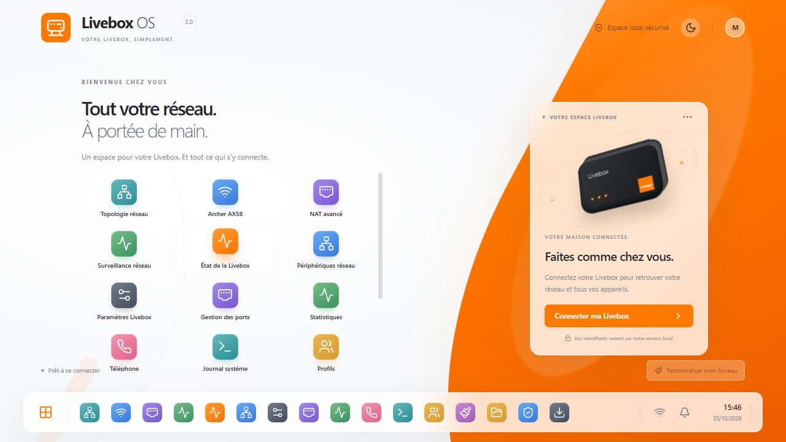
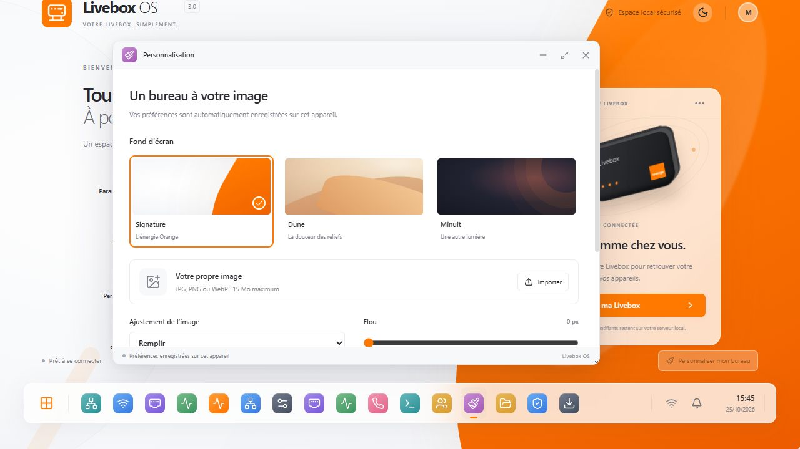
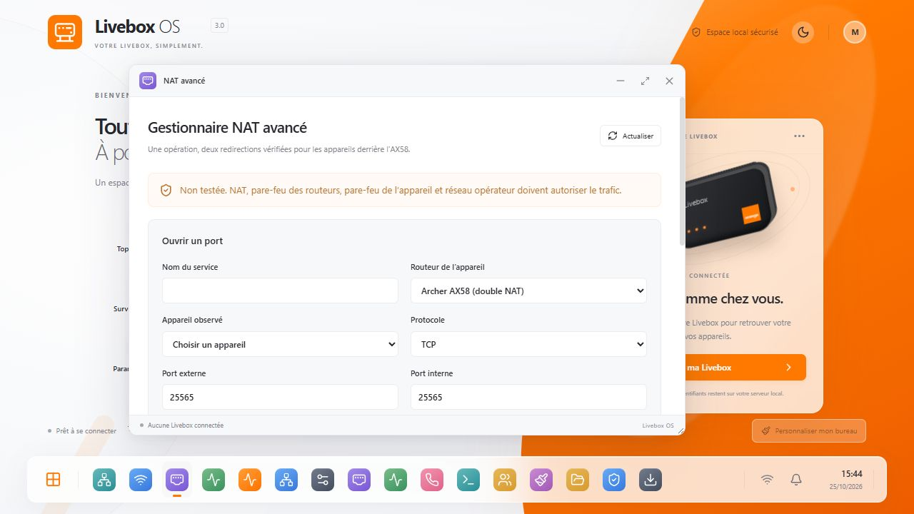

<div align="center">


# Livebox OS 3.0 🍊

**Your routers. Your network. Your desktop.**  
**Vos routeurs. Votre réseau. Votre bureau.**


[](LICENSE)


[English](#english) · [Français](#français) · [Installation](docs/INSTALL.md) · [Security](SECURITY.md) · [Contributing](CONTRIBUTING.md) · [Changelog](CHANGELOG.md)

</div>



<a id="english"></a>
## English

Livebox OS is a free, open-source, local web desktop for administering an **Orange Livebox 5** and an optional **TP-Link Archer AX58**. It uses real router APIs through a Python/FastAPI backend, with a React/TypeScript/Tailwind desktop and WebSocket updates. It is an independent project, not an Orange, Free or TP-Link product.

No cloud account, maintainer server or external service is required to run it. Router addresses are configurable in the login forms and profiles. The interface is currently in French; this documentation is bilingual. The screenshots show the real application with an empty local configuration, not simulated connected devices.

### Features

| Area | Available functionality |
|---|---|
| Desktop | Draggable, resizable, minimizable windows; taskbar; notifications; context menu; light/dark themes |
| Livebox | Connection, firmware, uptime, WAN counter-based graphs, known devices, Wi-Fi bands and DHCP settings |
| Archer AX58 | Firmware-specific authentication, WAN/LAN, clients, Wi-Fi reads, available CPU/memory data and confirmed NAT operations |
| Double NAT | Prepare Livebox → Archer WAN → destination device, detect port conflicts, confirm, write and read back both rules |
| Managed operations | Coordinated update/delete, audit trail, partial/unknown states and rollback limited to newly created matching rules |
| Tools | Topology based on router observations, monitoring, ping/API/DNS/HTTPS diagnostics, call history where supported |
| Personalization | Built-in backgrounds, JPG/PNG/WebP import, fit/blur preferences, portable application backups |
| Storage | USB capability detection and explicit read-only SMB2/3 shares with browsing and downloads |

An unsupported or unreadable service is reported as unavailable. A NAT rule being present **does not prove that a port is publicly reachable**. Existing rules are preserved and are not silently adopted into coordinated operations.

### Compatibility

| Device | Scope of verification |
|---|---|
| Orange Livebox 5 | Real authentication, status, NAT reads and temporary NAT creation/deletion verified on one installation |
| TP-Link Archer AX58 V1.0 | Real authentication and NAT creation/deletion verified with **1.5.2 Build 20250812 rel.38324(4555)** |
| Other Livebox / TP-Link models or firmware | Not established; do not assume compatibility |
| Windows / Linux | Native Python and Docker installation paths; Windows 64-bit and Debian Docker checks described in [validation](docs/VALIDATION.md) |

AX58 writes are blocked unless the backend confirms the expected hardware/firmware. TP-Link Wi-Fi writes and its firewall API are not enabled. SMB browsing is implemented but a real authenticated share has not been hardware-validated. See [known limitations](#known-limitations).

### Quick start

Install [Docker Desktop](https://docs.docker.com/desktop/) on Windows or [Docker Engine and Compose](https://docs.docker.com/engine/install/debian/) on Linux. Clone this repository, or download and extract its source archive, then open a terminal in its root:

```sh
docker compose up -d --build --wait
```

Open **http://localhost:8097**. The default binding is loopback only. For the first administrator account, approve the browser's pairing reference from a terminal on the Docker host:

```sh
docker compose exec -T backend python -m backend.auth approve-pairing REFERENCE_FROM_THE_PAGE
```

Replace `REFERENCE_FROM_THE_PAGE` with the non-secret reference displayed in your browser. Return to the **same browser** and create your own application account. There is no shipped administrator password.

Then choose **Connecter ma Livebox**, enter your router's private address and its administrator password. **Archer AX58** is optional and has its own form. These passwords belong only in those forms, never in Git, `.env`, issues or email. Full Windows/Linux, native installation, private-network access and upgrade instructions are in [INSTALL.md](docs/INSTALL.md).

### Double NAT

For a device behind the Archer, open **NAT avancé**, select the observed destination and enter the service name, ports and protocol. Review the prepared plan before confirming:

```text
Internet → Livebox rule → Archer WAN address
                          Archer rule → destination on Archer LAN
```

The backend verifies the actual WAN/LAN subnets and conflicts before writing. It re-reads both routers afterward. A failure can leave a partial or unknown result because the two APIs do not offer an atomic transaction. Only newly created rules matching the operation may be rolled back automatically. Existing rules require their own explicit confirmation.

### Known limitations

- Hardware testing covers the specific models/firmware above, not entire router families.
- Router APIs can change with firmware updates. Expired sessions require reconnection; sessions are intentionally lost on backend restart.
- TP-Link Wi-Fi is read-only. Its firewall API and the destination device's firewall are not inspected.
- USB hardware detection does not imply file access. The Livebox 5 USB file operations remain unavailable; SMBv1 is not re-enabled. Explicit SMB2/3 shares are read-only, without DFS or links, limited to 2,000 entries and 32 MiB downloads.
- Call history and some statistics depend on the router's actual service availability. Missing/reset counters create gaps rather than invented samples.
- Diagnostics run from the backend. Optional Internet/DNS/HTTPS tests contact their named destinations; these tests are not required to operate the application.
- Application backups preserve profiles, appearance and wallpaper; they are not router firmware/configuration backups. Treat them as private files.
- One administrator account, in-memory sessions and one backend worker: this is not a public or multi-tenant administration service.

### Troubleshooting and FAQ

**Why can I not open it from another computer?** The port intentionally binds to `127.0.0.1`. Use an authenticated tunnel, or configure a specific private interface and allowed host as explained in [INSTALL.md](docs/INSTALL.md). Never forward this administration port from the Internet.

**Why is setup waiting for approval?** A fresh Docker install requires a reference approval from its host terminal. This does not require the maintainer's SSH server. Keep the browser cookie and approve the reference before it expires.

**Is the Wi-Fi password the router password?** Not necessarily. Use the administrator password accepted by the router's own web interface. The Livebox OS account is a separate account.

**Why does the Archer work in one browser but not another?** Router sessions are scoped to the application/browser session. Connect in the browser you want to use. Replacing another TP-Link administrator session requires checking its explicit confirmation option.

**Does opening a port guarantee access?** No. Check the service listener, both router firewalls, the destination firewall and possible upstream NAT/ISP restrictions. No automatic public reachability claim is made.

**Will it reset my network?** No reset or topology migration is performed. Network writes require review and confirmation. Read-only checks do not create NAT rules.

**Is it really free?** The original project code is MIT licensed, with no license fee. Third-party components retain their own terms. There is no paid support or uptime guarantee.

<a id="français"></a>
## Français

Livebox OS est un bureau web **gratuit, open source et local** pour administrer une **Orange Livebox 5** et, facultativement, un **TP-Link Archer AX58**. Il communique réellement avec les routeurs via son backend Python/FastAPI. Son bureau React/TypeScript/Tailwind conserve les fenêtres, thèmes, fonds d'écran et applications du projet existant.

Il ne nécessite aucun compte cloud ni accès au serveur du mainteneur. Les adresses des routeurs sont modifiables dans les formulaires et profils ; aucun scan de réseau n'est imposé. Projet indépendant, sans affiliation avec Orange, Free ou TP-Link.

### Fonctionnalités et compatibilité

- Bureau avec fenêtres déplaçables, redimensionnables et minimisables, barre des tâches, horloge, notifications et clic droit.
- État réel de la Livebox, appareils, compteurs WAN et graphiques, Wi-Fi, DHCP, NAT/PAT et journal d'appels si disponible.
- Connexion AX58, WAN/LAN, clients, Wi-Fi en lecture, mesures disponibles et gestion NAT confirmée.
- Assistant double NAT, contrôle des sous-réseaux, conflits, relecture des deux règles, modification/suppression coordonnées des opérations gérées et audit.
- Topologie, surveillance, diagnostics, personnalisation persistante, sauvegardes applicatives et partages SMB2/3 en lecture seule.

Les tests matériels concernent **une Livebox 5** et un **Archer AX58 V1.0 sous 1.5.2 Build 20250812 rel.38324(4555)**. Ils ne prouvent pas une compatibilité avec tous les routeurs. Les écritures AX58 sont bloquées si l'identité attendue n'est pas confirmée. Les services non pris en charge restent indiqués comme indisponibles, sans données inventées.

### Installation et identifiants

Depuis un clone ou une archive extraite, avec Docker et Compose installés :

```sh
docker compose up -d --build --wait
```

Ouvrez **http://localhost:8097**, validez la référence affichée avec la commande ci-dessous dans le terminal de l'hôte Docker, puis créez votre compte dans le même navigateur :

```sh
docker compose exec -T backend python -m backend.auth approve-pairing REFERENCE_AFFICHEE
```

Connectez ensuite la Livebox dans **Connecter ma Livebox**, puis le TP-Link dans **Archer AX58** si vous en avez un. Saisissez leurs mots de passe d'administration dans les formulaires. Aucun mot de passe par défaut n'est livré ; aucun identifiant de routeur ne doit être mis dans `.env` ou publié.

Le [guide d'installation Windows/Linux](docs/INSTALL.md) détaille l'installation native, `.env.example`, les ports, l'accès privé, les mises à jour et le dépannage.

### Double NAT et limites

Dans **NAT avancé**, choisissez l'appareil observé derrière l'AX58, les ports et TCP/UDP. Vérifiez puis confirmez le plan Livebox → WAN AX58 → appareil. Le backend contrôle les conflits et relit les deux règles. Un échec partiel est possible : seules les nouvelles règles identifiées peuvent être retirées automatiquement. Les règles préexistantes sont conservées.

**Une règle présente ne prouve jamais l'accessibilité publique d'un port.** Pare-feu, service local et réseau opérateur doivent aussi l'autoriser.

Le Wi-Fi TP-Link reste en lecture seule ; son pare-feu et celui de l'appareil cible ne sont pas inspectés. Aucun accès USB Livebox incompatible n'est simulé et SMBv1 n'est pas réactivé. Les partages SMB2/3 sont en lecture seule et n'ont pas encore été validés sur un partage authentifié réel. Les sessions doivent être rouvertes après redémarrage du backend. Consultez les [résultats de validation](docs/VALIDATION.md) et la [politique de sécurité](SECURITY.md).

### FAQ et dépannage

**L'appairage exige-t-il mon serveur personnel ?** Non : la commande s'exécute sur votre propre hôte Docker, directement ou via votre propre accès SSH.

**Pourquoi un autre navigateur n'est-il pas connecté ?** Chaque session applicative possède ses propres connexions aux routeurs. Reconnectez-les dans le navigateur utilisé.

**Pourquoi « Non disponible » ?** La réponse réelle peut manquer, être refusée ou ne pas être compatible. Les détails de l'API expliquent le cas ; aucune valeur n'est fabriquée.

**Pourquoi rien sur le port ouvert ?** Vérifiez qu'un service écoute, puis les deux règles, les pare-feu et le réseau opérateur. La présence d'une règle ne suffit pas.

**La sauvegarde contient-elle mes mots de passe ?** L'export applicatif les exclut. Il peut néanmoins contenir vos profils, noms, adresses privées et image : gardez-le privé.

### 🤖 À propos de l'intelligence artificielle

Livebox OS a été développé avec l'aide de l'intelligence artificielle, notamment ChatGPT Codex.

Je préfère être transparent sur ce point plutôt que de le cacher.

Si vous n'aimez pas les projets développés avec l'IA, je respecte totalement votre opinion. Vous êtes libre de ne pas utiliser Livebox OS.

Les signalements de bugs, suggestions et critiques constructives sont les bienvenus.

En revanche, merci de ne pas me contacter uniquement pour me dire que le projet est « AI slop » ou « vibe coded slop ».

**Oui, je sais que le projet utilise l'IA. C'est littéralement écrit ici. 🍊**

### About artificial intelligence

Livebox OS was developed with help from artificial intelligence, including ChatGPT Codex. I prefer to be transparent about that.

If you dislike AI-assisted projects, I respect your opinion and you are free not to use Livebox OS. Bug reports, suggestions and constructive criticism are welcome. Please do not contact me only to call the project “AI slop” or “vibe coded slop”. **Yes, I know it uses AI. It is literally written here. 🍊**

## Screenshots / Captures d'écran




These are captures of the unchanged interface running locally with no connected routers, device list, personal wallpaper or private configuration. They are not evidence of a live connection. Hardware tests are documented separately.

Captures réelles d'une installation locale vierge, sans routeur connecté, appareils, fond personnel ou configuration privée. Elles ne simulent pas une connexion ; les tests matériels sont décrits séparément.

## Credits and licenses / Crédits et licences

- Original Livebox OS code: [MIT](LICENSE). Third-party code, fonts, libraries and base images retain their own licenses; see [THIRD_PARTY_NOTICES.md](THIRD_PARTY_NOTICES.md).
- [LiveboxMonitor](https://github.com/p-dor/LiveboxMonitor), by Pierre Dor, informed the Livebox protocol study. Its MIT notice is retained in `licenses/LiveboxMonitor-MIT.txt`.
- [TP-Link-Archer-C6U](https://github.com/AlexandrErohin/TP-Link-Archer-C6U) was studied as a reference; it is GPLv3. Its code is not included or a runtime dependency. The AX58 connector is an independent implementation based on the firmware's observed protocol; vendor bundles are not redistributed.
- React, Tailwind CSS, Lucide, FastAPI, Starlette, Uvicorn, HTTPX, Argon2, cryptography and smbprotocol make this project possible. License inventories and notices accompany the source.
- The desktop experience was inspired by Freebox OS. No Freebox screenshots, vendor application icons or firmware code are shipped. Names and trademarks belong to their respective owners; the MIT license grants no trademark rights.

## Contact

**Contact :** [trim@kirbytrim.buzz](mailto:trim@kirbytrim.buzz)

For bug reports, technical questions, suggestions and security problems. Public issues may also be used for non-sensitive bugs; use [SECURITY.md](SECURITY.md) for private vulnerability reports.

Pour les signalements de bugs, questions techniques, suggestions et problèmes de sécurité. **Ne transmettez jamais de mots de passe, jetons, cookies, sauvegardes complètes ou configurations sensibles.**

**Never send passwords, tokens, cookies, full backups or sensitive configurations.**
